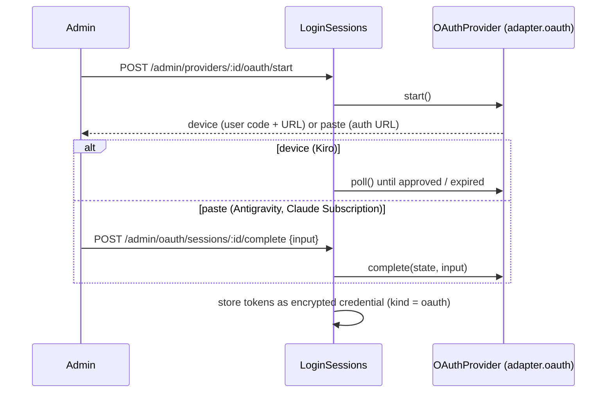

# Provider adapters and credentials

## Adapter contract

`providers/adapter.ts` defines `ProviderAdapter`; `ADAPTERS` maps a provider `type` to its adapter. An adapter turns the canonical OpenAI chat-completions request (`UpstreamCall.body`, model already rewritten) into one upstream call and returns a `Response` in OpenAI shape: JSON when `stream` is false, SSE (usage in the final chunk) when true. Non-2xx upstream responses are returned as-is so the gateway can classify them; only transport errors throw. `providers/chunks.ts` builds/aggregates the OpenAI chunk shape.

| `type`                 | Adapter                           | Credential                        | Models                          | Origin                 |
| ---------------------- | --------------------------------- | --------------------------------- | ------------------------------- | ---------------------- |
| `openai-compat`        | `providers/openai-compat.ts`      | API key (Bearer)                  | fetched `GET {base_url}/models` | original               |
| `anthropic`            | `providers/anthropic.ts`          | API key (`x-api-key`)             | fetched, paginated              | adapted from opencodex |
| `claude-subscription`  | `providers/claude-subscription/`  | Claude Pro/Max OAuth (paste flow) | fetched, paginated              | adapted from oh-my-pi  |
| `antigravity`          | `providers/antigravity/`          | Google OAuth (paste flow)         | static list                     | adapted from opencodex |
| `chatgpt-subscription` | `providers/chatgpt-subscription/` | ChatGPT OAuth (paste flow)        | static list                     | adapted from oh-my-pi  |
| `kiro`                 | `providers/kiro/`                 | AWS SSO OIDC (device flow)        | static list                     | adapted from opencodex |

The adapted adapters keep opencodex's wire knowledge but target this repo's chat-completions interface; see [../project-pdr/opencodex-origin.md](../project-pdr/opencodex-origin.md) for what was ported and what was not.

Optional adapter members: `oauth` (enables login + refresh), `staticModels` (wins over `listModels`), `quota` (account allowance: Kiro, Antigravity, Claude Subscription and ChatGPT Subscription), `defaultBaseUrl` (null = `base_url` mandatory).

Every upstream request carries `UpstreamCall.headers` (also on `ModelListCall` and `QuotaCall`): the provider's custom headers with the chosen credential's overrides on top, merged by `mergeHeaders` (`upstream-headers.ts`). An adapter applies them last, so a name it sets itself (e.g. `authorization`) can be overridden on purpose; the admin API refuses the names that frame the request or the connection (`host`, `content-length`, hop-by-hop ones).

`anthropic` and `claude-subscription` share one Messages translation, `createAnthropicAdapter(flavor)` in `providers/anthropic.ts`. A flavor supplies the credential headers (given the account's `meta`), may serialise and rewrite the translated request (`prepare`, which returns the body bytes and any headers that depend on them), set the Messages URL query (`messagesQuery`), name a 4xx rejection worth one resend (`retryRejection`), and rewrite each answer chunk (`restore`); the subscription flavor uses these for the Claude Code billing block and its `cch` signature, the identity blocks, `metadata.user_id`, `_` tool-name wrapping and the "Claude Code too old" version adoption.

## Registry and pool

- `Registry` (`registry.ts`): in-memory snapshot of providers, credentials (decrypted) and aliases from SQLite. Admin writes call `reload()`; selector instances survive a reload while the strategy is unchanged.
- `CredentialPool` (`pool/pool.ts`): picks a credential per request and holds in-memory health: in-flight count, cooldown with backoff (429: 30 s–10 min, 5xx: 5 s–5 min, 403: 5 min–1 h, or `Retry-After`), per-credential rpm window, sticky sessions (max 10 000). Returns a `Lease` (`ok`, `fail`, `release`).
- Strategies (`pool/selectors.ts`): `round_robin`, `weighted`, `least_inflight`, `least_used`, `fill_first`, `random`; credentials are also filtered by `models` globs, `priority` and `enabled`/`status`.
- `markDead` persists a terminal failure so a credential stays out of rotation across restarts.

## OAuth accounts

- `LoginSessions` keeps pending logins in memory only; a restart drops unfinished ones.
- `TokenManager` refreshes shortly before expiry, shares one refresh among concurrent callers (refresh tokens are often single-use), and persists the result encrypted via `Registry.saveTokens`.
- `OAuthRefreshError.terminal` retires the account until it signs in again; anything else only cools it down.
- Provider-specific fields that must survive refreshes (project id, profile ARN, regions, client registration) live in `OAuthTokens.extra`.

## Account quota

`QuotaService` (`quota/service.ts`) reads each OAuth account's allowance through `adapter.quota()` (`providers/kiro/quota.ts`, `providers/antigravity/quota.ts`, `providers/claude-subscription/quota.ts`, `providers/chatgpt-subscription/quota.ts`; shared types and parsing helpers in `quota/`). Readings are cached (10 min, failures 1 min) and probes are single-flight; a token is resolved through `TokenManager` (with one forced refresh on 401). An account whose reading is `exhausted` is parked in `CredentialPool` (`park(id, until)`, separate from the failure cooldown and not cleared by a successful request) until the reset time. A window with a `scope` (a model scope the adapter names through `modelScope(model)`, e.g. `opus`) parks only that scope (`park(id, until, scope)`); `acquire` takes the request's scope, and a 429 for a `local` scope cools that scope only (`Lease.fail`). A full probe lifts what it finds healthy, and lifts a scope's 429 cooldown (`healScope`) only when the reading is `complete`. An adapter that sees allowance in its answers (rate-limit headers) hands it to `UpstreamCall.observe`, which reaches `QuotaService.observe`: merged into the cached reading, it can park but never lift. Triggers: the admin endpoints (`GET /admin/providers/:id/quota`, `/admin/credentials/:id/quota`), a periodic sync (`QUOTA_SYNC_INTERVAL_MINUTES`), the response headers above and a 429 from an OAuth account in the request pipeline (at most one probe per account per minute).

## Secrets at rest

`crypto.ts` `SecretBox` (AES-256-GCM, key = `MASTER_KEY`) seals credentials via `credentials.ts` (`sealAuth`/`openAuth`). Virtual keys store only a SHA-256 hash plus a display prefix.

## Model catalog

`ModelCatalog` (`models.ts`) stores each provider's model list in `provider_models` / `provider_model_sync`: fetched on first view, on `POST …/models/refresh`, at startup and every `MODEL_SYNC_INTERVAL_HOURS`. A failed refresh keeps the previous list. OAuth providers copy the adapter's static list. Any id works as `provider/<id>` whether or not listed. Operators can switch single models off (`disabled_models`, applied by `Registry.resolve` and `ModelCatalog.all`).

Operators can also add models by hand (`PUT /admin/models/:provider/:model`, table `custom_models`; `DELETE` removes one). A custom model carries the same facts as a listed one (name, description, release date, context window, max output, modalities, parameters), joins the provider's list at read time (so it survives refreshes, also on static providers), replaces a listed model of the same id and is offered on `/v1/models` like any other. Prices stay in the pricing overrides.

`ModelTester` (`model-tests.ts`, `POST /admin/model-tests {provider, model}`) sends one non-streaming request ("reply with ok", `max_tokens` 32, retried once as `max_completion_tokens` for models that refuse it) to exactly that `provider/model` with one of the provider's credentials, trying the next credential when one is refused (401/403/408/429/5xx). It is a diagnosis, not traffic: no virtual key, no usage record, and credential cooldowns are left alone. The outcome (`ok`, upstream status, latency, error, start of the reply, credential label) replaces the model's row in `model_tests` and shows as `last_test` in the admin model lists. The Models page runs "test all/shown" as one request per model, four at a time, and asks first above ten.

Each `ModelInfo` carries what the upstream reports: name, description, created, context window, max output tokens, input/output modalities and supported parameters (`readModelDetails` in `providers/model-list.ts` understands the OpenRouter, Anthropic, Gemini and OpenAI spellings). Only what the upstream reported is stored (`provider_models.details`). Gaps are filled at read time by `ModelMetadataStore` (`model-metadata.ts`) from OpenRouter's `GET /models`, saved to `model_metadata` by the pricing sync and matched with the pricing id matcher; the field's origin is kept in `sources`. Upstream values are never overwritten, and prices always come from `PricingStore`, so a listed price is the one billed. `GET /v1/models` (`client-models.ts`) adds the OpenRouter-style fields to the OpenAI shape (`name`, `context_length`, `architecture`, `pricing`, `top_provider`, `supported_parameters`; `description` only with `?verbose=1`); unknown facts are omitted.
